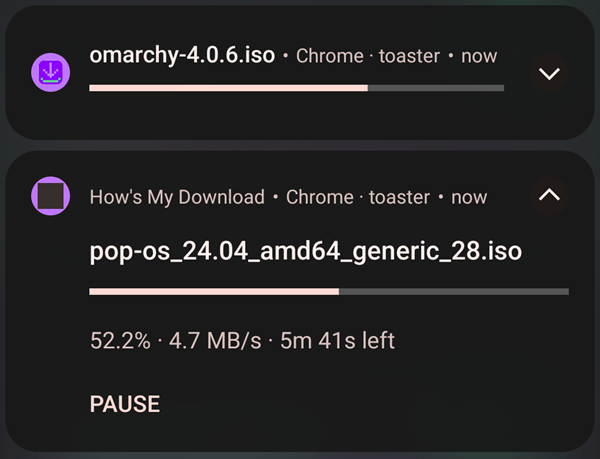
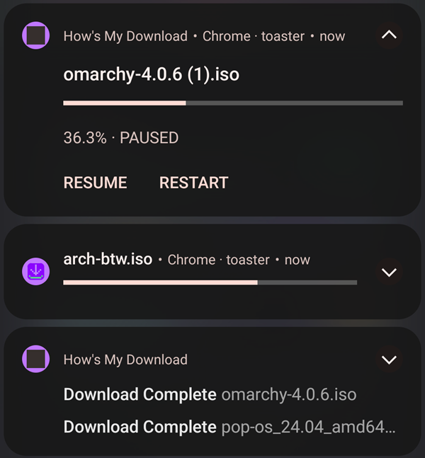
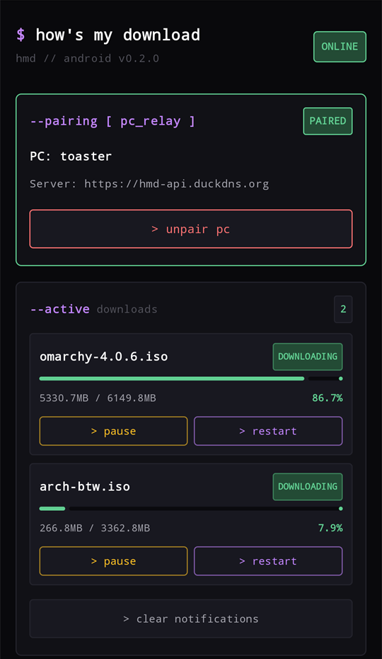
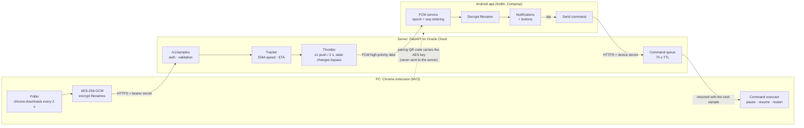

<p align="center">
  
</p>

<h1 align="center">How's My Download</h1>

<p align="center">
  Your Chrome downloads, live on your Android phone: progress, speed and ETA in the notification shade,<br>
  with <b>Pause / Resume / Restart</b> buttons that act on the PC. Filenames are end-to-end encrypted.
</p>

<p align="center">
  <a href="https://github.com/W0NB0N/HowsMyDownload/actions/workflows/ci.yml"></a>
  
  
  
  
  
</p>

<table align="center">
  <tr>
    <td align="center"><br><sub>Live progress, speed and ETA</sub></td>
    <td align="center"><br><sub>Paused, running and completed</sub></td>
    <td align="center"><br><sub>The app</sub></td>
  </tr>
</table>

## Why

Large downloads (an OS image, a game update, a dataset) take long enough that you walk away, and then you keep walking back to check. How's My Download mirrors Chrome's download manager onto your phone and lets you act on it from there.

## Measured, not estimated

Measured on 24 Oct 2026 against the production server (Oracle Cloud, India) with a POCO M4 Pro on 4G. Methods, raw data and caveats are in [`docs/metrics.md`](docs/metrics.md).

| | Median | Spread |
|---|---|---|
| Server → phone push (386 pushes, clock-offset corrected) | **448 ms** | p95 680 ms, p99 782 ms |
| Tap **Pause** on the phone → Chrome paused → phone shows PAUSED | **1.8 s** | 1.4–2.2 s |
| Tap → "Pausing…" feedback | **219 ms** | 181–255 ms |
| Server handling per sample (in-process) | **1.5 ms** | p95 1.9 ms |

Measuring found a real bug. The pause round trip was first **4.1 s**: an extension state change waited for the next 2 s poll tick. The fix halved it, and a regression test now guards it.

## How it works



1. **Pairing.** The extension asks the server for a pairing code and shows a QR code with the server URL, the code and a fresh **AES-256 key**. The phone scans it and claims the code with its FCM token. The key travels only through the camera; the server never has it.
2. **Progress.** While a download runs, the extension sends a sample every 2 s with the filename encrypted. The server smooths speed (EMA), computes the ETA, and pushes an FCM data message, throttled to one every 2 s; state changes push immediately. The app decrypts the name and updates one notification per download.
3. **Commands.** A tap on Pause posts a command to the server, which queues it. The extension picks it up from the response to its next sample (or a light poll when nothing is transferring), applies it through `chrome.downloads`, and samples at once so the phone sees the result. Failures ("Chrome can't resume this one", "PC didn't respond") come back as a push with a plain reason.

## Engineering highlights

- **End-to-end encrypted filenames.**
  - Filenames and MIME types are encrypted with AES-256-GCM on the PC (`enc:v1:<iv>:<ciphertext>`). Encryption **fails closed**: an unencryptable sample is dropped, never sent in plaintext.
  - A cross-language test checks that Kotlin decrypts what the extension's Web Crypto code produced (`CryptoUtilsTest`).
  - On the phone, the key and the device secret are wrapped with an Android Keystore key.
- **Two credentials per pairing.** The extension and the phone each hold their own 256-bit bearer secret, stored server-side as SHA-256 hashes. Only the phone can redirect pushes or send commands; only the extension can collect them. An unknown pairing and a wrong secret both return `401`, so IDs can't be probed.
- **Ordering across restarts.** FCM may reorder messages, and the server's sequence counter resets on restart. Every push carries `(epoch, seq)`. The phone compares `seq` only within one server boot epoch ([`SequenceGate.kt`](android/app/src/main/java/com/notifs/app/service/SequenceGate.kt)).
- **Throttling without lag.** Bursts are coalesced into at most one push per 2 s per pairing, while state changes bypass the window. FCM sends happen outside locks, under a per-pairing FIFO, so one slow push never stalls another user. Payloads are packed by priority into a 3.5 KB budget under FCM's 4 KB cap.
- **Remote control with feedback.**
  - Each download has at most one pending command, and a newer tap replaces it. Delivery is at-most-once, with a 75 s expiry that tells the phone "PC didn't respond".
  - Error codes come from a fixed list, so no free text from the PC reaches the phone.
  - Restart re-downloads the original URL without a Save-As dialog on the PC, and reports the old entry as erased.
- **"PC offline" that survives process death.** An `AlarmManager` watchdog, re-armed by every push, alerts after 90 s of silence even if Android has killed the app. It doesn't rely on in-memory state or visible notifications.
- **Tested across three languages.**
  - Server: pytest (128 tests, 83% coverage) plus a Firestore emulator suite for the transactional claim.
  - Extension: 41 Node tests that run the real modules against a `chrome.*` fake.
  - Android: 33 JUnit tests.
  - All of it runs in CI on every push.

## Repository

| Path | Contents |
|---|---|
| [`server/`](server) | FastAPI app: ingest, pairing, commands, tracker, throttler, FCM notifier, Firestore and in-memory stores |
| [`extension/`](extension) | Chrome MV3 extension, plain ES modules, no build step, no dependencies |
| [`android/`](android) | Kotlin + Jetpack Compose app |
| [`deploy/`](deploy) | Dockerfile, Compose, Nginx, systemd unit, VM setup script, Firestore rules |
| [`tools/`](tools) | Measurement tools (latency, clock offset, command loop, RTT), benchmark, trace replay, packaging |
| [`docs/`](docs) | [Protocol](docs/protocol.md), [metrics](docs/metrics.md), [self-hosting](docs/self-hosting.md), [architecture decisions](docs/ADR-0001-architecture.md), [design tokens](docs/design.md), [store listing](docs/store-listing.md) |

## Running it locally

```bash
# Server (Python 3.12): console notifier and in-memory store by default
python -m venv .venv && source .venv/bin/activate     # Windows: .venv\Scripts\activate
pip install -e "./server[dev]"
uvicorn server.main:app --reload --port 8000

# Tests (from the repository root)
(cd server && ruff check . && pytest --cov)
(cd extension && node --test test_poller.js test_crypto.js test_api.js test_commands.js)
(cd android && ./gradlew testDebugUnitTest assembleDebug)   # needs android/app/google-services.json
```

- **Extension:** open `chrome://extensions`, enable *Developer mode*, choose *Load unpacked* → `extension/`, set the server URL in the popup, and click *pair device*.
- **Without a phone:** replay a recorded download with `python tools/sample_replay.py tools/sample_traces/ubuntu_download_trace.json`. The server's console notifier prints each push with speed and ETA.

## Self-hosting and releases

Pushes are tied to the Firebase project the app was built with, so running your own server means using your own Firebase project and your own build of the app. [`docs/self-hosting.md`](docs/self-hosting.md) covers it end to end:
- **Release workflow:** [`.github/workflows/release.yml`](.github/workflows/release.yml) builds a signed APK and the extension zip from your repository secrets.
- **GitHub Releases:** pushing a `vX.Y.Z` tag publishes them as a release.

## Limitations

- Chrome on the PC and Android on the phone only; delivery needs Google Play Services (FCM).
- Pending commands and push sequencing live in server memory, so the server runs as a single worker, and a restart drops queued commands.
- Restart can't re-create downloads that came from a form POST or a `blob:` URL.
- Phone battery cost hasn't been measured yet ([how to](docs/metrics.md#4-not-yet-measured)).

## License

[MIT](LICENSE)
