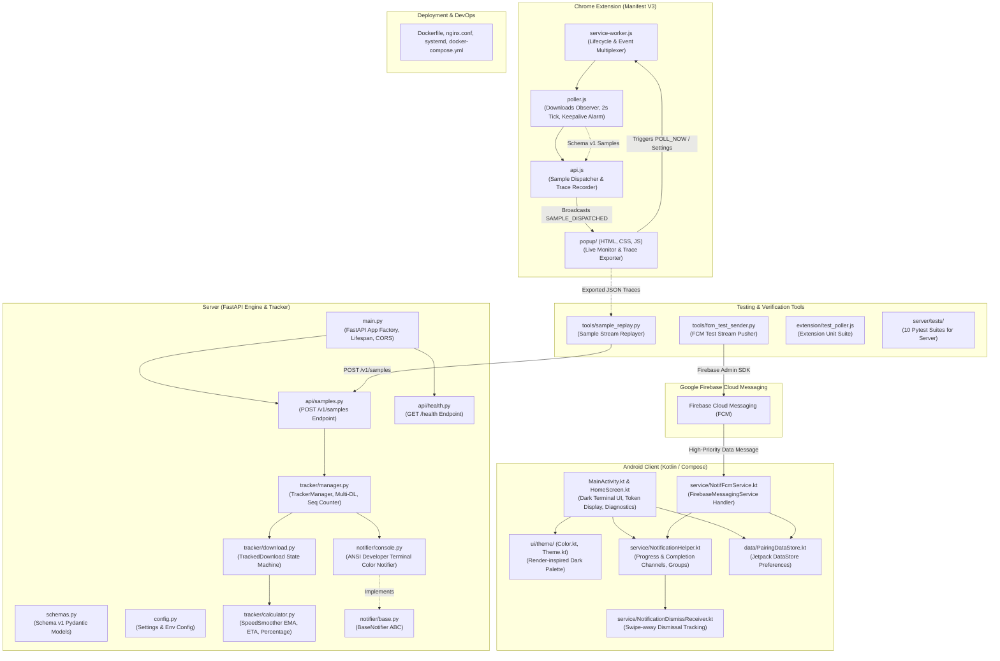

# Current Build Status & Architecture Topology

*Last Updated: Phase 3 Completion (Android App Standalone + FCM)*

---

## 1. Abstracted Module Graph

---

## 2. Implemented Modules & Responsibilities

| Module / Component | Path | Responsibility & Implemented State | Inter-module Connection |
|---|---|---|---|
| **Android Main Activity & Screen** | `android/.../MainActivity.kt` | Jetpack Compose developer UI. Displays live FCM device token with copy action, manages `POST_NOTIFICATIONS` permission prompt, and provides local test notification triggers. | Coordinates `NotificationHelper` and `PairingDataStore`. |
| **Android Notification Helper** | `android/.../service/NotificationHelper.kt` | Manages notification channels (`downloads` low importance silent, `completions` default audible), builds live progress notifications with speed/ETA/percentage, completion alerts, and multi-download group summaries. | Invoked by `NotifFcmService` and `MainActivity`. |
| **Android FCM Service** | `android/.../service/NotifFcmService.kt` | Background `FirebaseMessagingService`. Ingests FCM data messages, parses downloads JSON, checks sequence ordering, filters dismissed transfers, and routes to `NotificationHelper`. | Wires Google Play Services FCM to Android Notification system. |
| **Notification Dismiss Receiver** | `android/.../service/NotificationDismissReceiver.kt` | Broadcast receiver capturing notification swipe-away `deleteIntent` to prevent unwanted re-posts. | Records dismissal in `PairingDataStore`. |
| **Android Data Store** | `android/.../data/PairingDataStore.kt` | Local preference management using AndroidX DataStore for FCM tokens, last processed sequence numbers, and dismissed download IDs. | Consumed by `NotifFcmService` and `MainActivity`. |
| **Android Terminal Theme** | `android/.../ui/theme/` | Material 3 Dark theme implementing Render-inspired color palette (`#09090c`, `#8a05ff`, `#61cf92`, `#c084fc`) with monospace typography. | Styles all Android Compose UI components. |
| **FCM Push Testing Tool** | `tools/fcm_test_sender.py` | Python test tool simulating live FCM push streams directly to physical devices. Supports `--mode normal`, `stall`, `pause`, `fail`, `multi`. | Validates Android FCM reception in isolation. |
| **Server Engine** | `server/` | FastAPI backend with speed smoothing, ETA math, finite state machine, and console telemetry. | Standalone ingest and processing brain. |
| **Chrome Extension** | `extension/` | Chrome download monitor with 2s polling, keepalive alarms, and terminal popup. | Standalone source collector. |

---

## 3. Communication Contracts Active

- **Sample Ingestion**: Defined in `docs/protocol.md#1` (`POST /v1/samples`).
- **FCM Data Delivery**: Defined in `docs/protocol.md#2` (high-priority FCM data message).
- **LAN WebSocket**: Defined in `docs/protocol.md#3` (`/v1/ws`).
- **Pairing**: Defined in `docs/protocol.md#4` (ephemeral 6-digit code + hash-stored bearer secret).

---

## 4. Design System & Theme Tokens (Render-inspired Dark Terminal)

Applied across Chrome Extension, Server Terminal Logs, Android Native UI, and Notifications:

| Token | Hex / Value | Usage |
|---|---|---|
| `--bg-canvas` | `#09090c` / `#000000` | Deep terminal black background |
| `--bg-card` | `#111116` / `#141419` | Surface containers & cards |
| `--border-subtle` | `#23232c` | Minimalist dark borders |
| `--purple-brand` | `#8a05ff` | Primary action accent, focus glow, badge outlines, sequence tags |
| `--purple-light` | `#c084fc` | Command flag prefixes, ETA text, completed download state |
| `--green-neon` | `#61cf92` | Active download state, pulsing status LED, speed highlights |
| `--text-white` | `#ffffff` | Primary titles, filenames, terminal commands |
| `--text-dim` | `#a1a1aa` | Secondary stats, labels, progress details |
| `--text-muted` | `#52525b` | Comments, inactive indicators, timestamps |
| **Typography** | `Monospace / Code` | `ui-monospace, "JetBrains Mono", Menlo, Consolas` |
| **Iconography** | `11x11 Pixel Grid` | Custom pixel-matrix block glyphs ([`icon.png`](file:///d:/1shav/1shav.code/projects/notifs/icon.png)) |
