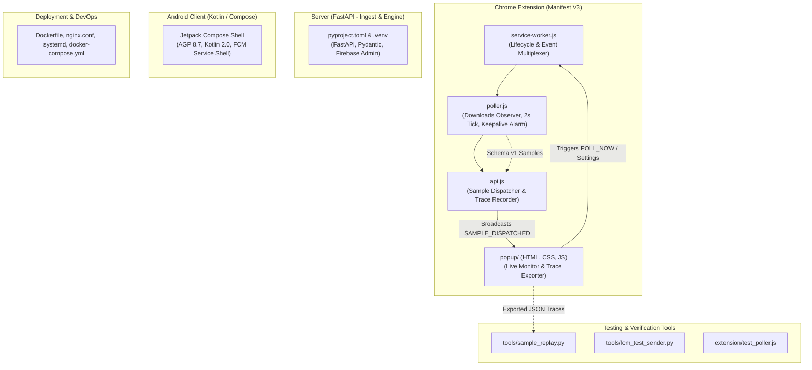

# Current Build Status & Architecture Topology

*Last Updated: Phase 1 Completion (Chrome Extension Standalone)*

---

## 1. Abstracted Module Graph

---

## 2. Implemented Modules & Responsibilities

| Module / Component | Path | Responsibility & Implemented State | Inter-module Connection |
|---|---|---|---|
| **Extension Lifecycle** | `extension/background/service-worker.js` | Top-level Manifest V3 service worker. Coordinates browser startup, install defaults, alarms, and message routing. | Wires `poller.js` to Chrome lifecycle events. |
| **Extension Poller** | `extension/background/poller.js` | Observes `chrome.downloads` (`onCreated`, `onChanged`, `onErased`), runs 2s polling tick while active, registers `chrome.alarms` keepalive, and normalizes download states to Schema v1. | Ingests from Chrome Downloads API ➔ passes structured batch to `api.js`. |
| **Extension API Client** | `extension/background/api.js` | Dispatches samples, formats colorized console telemetry in DevTools, maintains 50-sample circular trace buffer in `chrome.storage.local`. | Consumed by `poller.js` ➔ saves to local storage & notifies `popup.js`. |
| **Extension Popup UI** | `extension/popup/` (`popup.html`, `popup.css`, `popup.js`) | Displays live active download cards with real-time percentage progress bars, bytes/total stats, status badges (Active/Idle/Disabled), settings persistence, and sample trace export. | Communicates bidirectionally with `service-worker.js` via `chrome.runtime.sendMessage` and `chrome.storage.local`. |
| **Extension Unit Suite** | `extension/test_poller.js` | Automated Node.js unit tests verifying filename extraction, state mapping, and Schema v1 conformance. | Validates `poller.js` logic. |
| **Protocol Spec** | `docs/protocol.md` | Schema v1 defining contracts for `POST /v1/samples`, FCM data payload, LAN frames, and pairing handshake. | Authoritative source of truth for Extension, Server, and Android. |
| **Architecture Decision** | `docs/ADR-0001-architecture.md` | Documents rationale for Oracle VM, FCM data messages, and transport abstraction. | High-level system design guidelines. |
| **Server Backend (Scaffold)** | `server/` | Python 3.11+ project definition (`pyproject.toml`) with FastAPI, Pydantic v2, Firebase Admin, WebSockets, Ruff, Pytest installed in `.venv`. | Ingests from `extension`, relays to `Firebase FCM` / `Android`. |
| **Android Client (Scaffold)** | `android/` | Gradle multiplatform configuration with Material 3 Compose, CameraX, ML Kit, Firebase Messaging dependencies, and basic `MainActivity`. | Ingests from `Firebase FCM` / `LAN WebSocket`. |
| **Deployment Engine** | `deploy/` | Production `Dockerfile`, `nginx.conf` (SSL + WebSocket proxying), systemd service definition, and `docker-compose.yml` (self-hosting). | Hosts and exposes `server`. |
| **Developer Tools** | `tools/` | `sample_replay.py` (simulates client sample batches) and `fcm_test_sender.py` (simulates server-to-phone FCM pushes). | Used for isolated verification of Server & Android app. |

---

## 3. Communication Contracts Active

- **Sample Ingestion**: Defined in `docs/protocol.md#1` (`POST /v1/samples`).
- **FCM Data Delivery**: Defined in `docs/protocol.md#2` (high-priority FCM data message).
- **LAN WebSocket**: Defined in `docs/protocol.md#3` (`/v1/ws`).
- **Pairing**: Defined in `docs/protocol.md#4` (ephemeral 6-digit code + hash-stored bearer secret).
