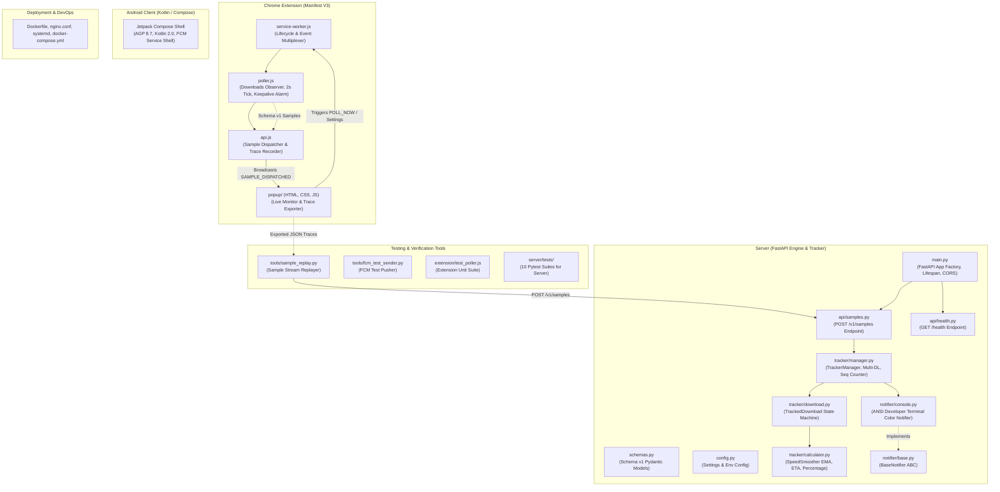

# Current Build Status & Architecture Topology

*Last Updated: Phase 2 Completion (Backend Server Standalone)*

---

## 1. Abstracted Module Graph

---

## 2. Implemented Modules & Responsibilities

| Module / Component | Path | Responsibility & Implemented State | Inter-module Connection |
|---|---|---|---|
| **Server App Factory** | `server/main.py` | FastAPI application builder, CORS configuration, lifespan manager initializing `TrackerManager` and active `Notifier`. | Exposes HTTP routes; manages app-level singletons. |
| **Sample Ingestion API** | `server/api/samples.py` | `POST /v1/samples` route. Ingests raw batch from clients and routes to `TrackerManager`. | Connects external HTTP clients to internal tracking engine. |
| **Health Check API** | `server/api/health.py` | `GET /health` route returning service health, timestamp, and version `0.1.0`. | Monitoring and uptime verification. |
| **Schema v1 Models** | `server/schemas.py` | Pydantic v2 data models: `DownloadState` (StrEnum), `SourceDownloadItem`, `SamplePayload`, `EvaluatedDownloadItem`, `PushPayload`. | Shared contract layer across all server modules. |
| **Server Config** | `server/config.py` | Environment variable resolution via `pydantic-settings` (`NOTIFIER_TYPE`, `STORE_TYPE`, `HOST`, `PORT`, `DEBUG`). | Injected into server components. |
| **Download Tracker Engine** | `server/tracker/download.py` | Per-download finite state machine enforcing legal state transitions and maintaining byte counts. | Instantiated and managed by `TrackerManager`. |
| **Computation Engine** | `server/tracker/calculator.py` | Math utilities: `SpeedSmoother` (Exponential Moving Average), `calculate_percentage`, `calculate_eta`. Handles stalls and negative deltas. | Invoked by `TrackedDownload`. |
| **Tracker Manager** | `server/tracker/manager.py` | Orchestrates multi-download tracking across pairing IDs, manages per-pairing `seq` numbers, cleans up finished downloads, and dispatches to `Notifier`. | Bridges `api/samples.py` with `notifier/`. |
| **Console Notifier** | `server/notifier/console.py` | Developer-oriented terminal notifier with ANSI color codes (Render-inspired purple `#8a05ff` and green `#61cf92`), ETA, speed, and cross-platform UTF-8 handling. | Receives `PushPayload` from `TrackerManager`. |
| **Server Unit & API Tests** | `server/tests/` | 10 unit and integration tests covering calculations, state machine transitions, invalid states, multi-download tracking, and HTTP endpoints (100% pass). | Validates `server/` implementation. |
| **Extension Poller** | `extension/background/poller.js` | Observes `chrome.downloads`, runs 2s polling tick, keepalive alarms, normalizes to Schema v1. | Ingests from Chrome ➔ passes to `api.js`. |
| **Extension API Client** | `extension/background/api.js` | Dispatches samples, formats telemetry, maintains trace history buffer. | Saves to storage & notifies `popup.js`. |
| **Extension Popup UI** | `extension/popup/` | Terminal dark UI with 11x11 pixel glyphs, live progress cards, stats, settings, and trace export. | Interacts with `service-worker.js`. |
| **Replay Testing Tool** | `tools/sample_replay.py` | Replays recorded sample traces against the backend server at 2s intervals. | Verifies server and console rendering in isolation. |

---

## 3. Communication Contracts Active

- **Sample Ingestion**: Defined in `docs/protocol.md#1` (`POST /v1/samples`).
- **FCM Data Delivery**: Defined in `docs/protocol.md#2` (high-priority FCM data message).
- **LAN WebSocket**: Defined in `docs/protocol.md#3` (`/v1/ws`).
- **Pairing**: Defined in `docs/protocol.md#4` (ephemeral 6-digit code + hash-stored bearer secret).

---

## 4. Design System & Theme Tokens (Render-inspired Dark Terminal)

Applied across Chrome Extension, Server Terminal Logs, Android Native UI, and Notifications:

| Token | Hex / Value | Usage |
|---|---|---|
| `--bg-canvas` | `#09090c` / `#000000` | Deep terminal black background |
| `--bg-card` | `#111116` / `#141419` | Surface containers & cards |
| `--border-subtle` | `#23232c` | Minimalist dark borders |
| `--purple-brand` | `#8a05ff` | Primary action accent, focus glow, badge outlines, sequence tags |
| `--purple-light` | `#c084fc` | Command flag prefixes, ETA text, completed download state |
| `--green-neon` | `#61cf92` | Active download state, pulsing status LED, speed highlights |
| `--text-white` | `#ffffff` | Primary titles, filenames, terminal commands |
| `--text-dim` | `#a1a1aa` | Secondary stats, labels, progress details |
| `--text-muted` | `#52525b` | Comments, inactive indicators, timestamps |
| **Typography** | `Monospace / Code` | `ui-monospace, "JetBrains Mono", Menlo, Consolas` |
| **Iconography** | `11x11 Pixel Grid` | Custom pixel-matrix block glyphs ([`icon.png`](file:///d:/1shav/1shav.code/projects/notifs/icon.png)) |
