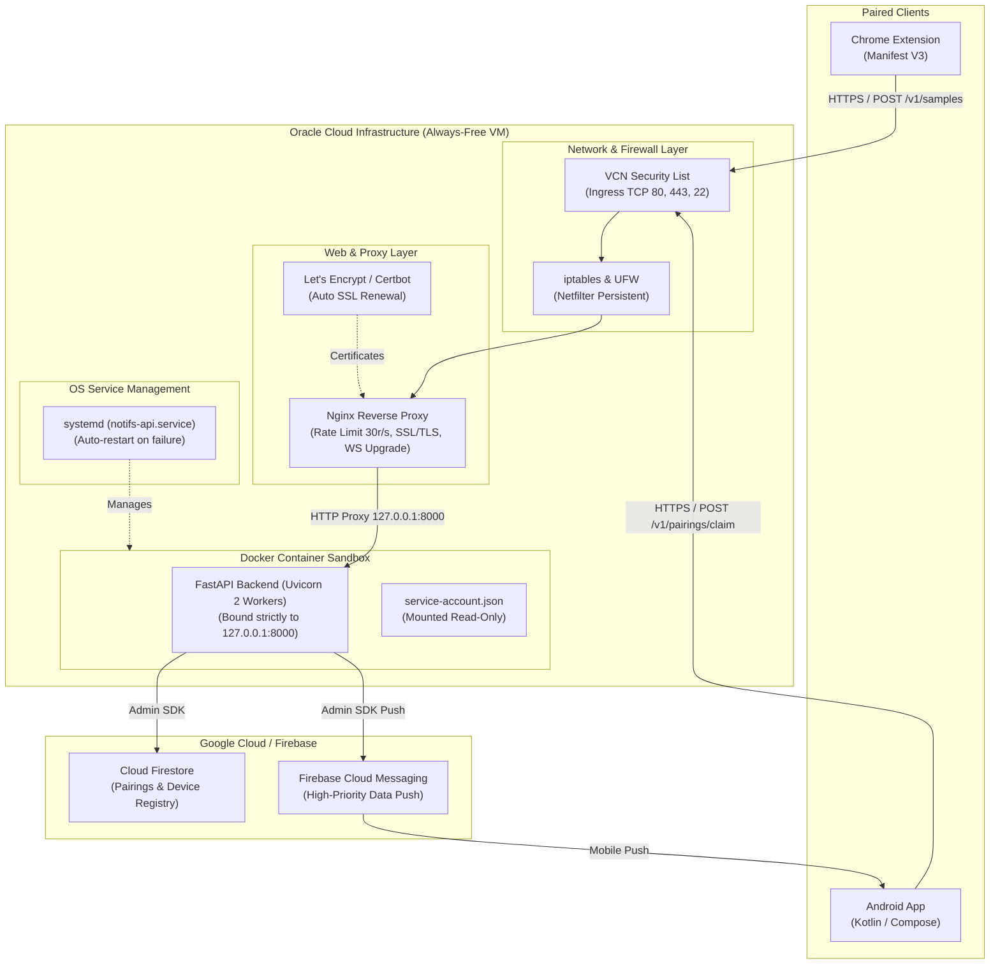

# How's My Download — Oracle Cloud VM Production Deployment Guide

This guide provides an end-to-end walkthrough for deploying the **How's My Download** FastAPI backend to an **Oracle Cloud Infrastructure (OCI) Always-Free VM** running Ubuntu with Docker, Nginx reverse proxy, SSL termination via Let's Encrypt, and systemd process orchestration.

---

## 1. System Architecture



---

## 2. Prerequisites

1. **Oracle Cloud Account**: Free tier eligible (Ampere A1 ARM with up to 4 OCPUs & 24 GB RAM, or AMD E2.1.Micro).
2. **Domain Name**: A custom domain or free dynamic DNS hostname (e.g. `notifs.yourdomain.com`, DuckDNS, Cloudflare) pointed to your Oracle Cloud VM's Public IP address via an **A Record**.
3. **Firebase Project**:
   - Cloud Firestore enabled in production mode.
   - A downloaded Service Account JSON key (`service-account.json`).
4. **Local Tools**: SSH client (`ssh`, `scp`) or Git.

---

## 3. Step-by-Step Walkthrough

### Step 1: Create the Oracle Cloud Compute Instance

1. Log in to the [Oracle Cloud Console](https://cloud.oracle.com).
2. Navigate to **Compute** $\rightarrow$ **Instances** $\rightarrow$ **Create Instance**.
3. Configure the VM:
   - **Name**: `notifs-backend`
   - **Image**: `Canonical Ubuntu 22.04` or `Canonical Ubuntu 24.04 Minimal/Full`.
   - **Shape**: 
     - *Recommended*: **Ampere (ARM)** `VM.Standard.A1.Flex` (1-2 OCPUs, 6-12 GB RAM).
     - *Alternative*: **AMD (x86_64)** `VM.Standard.E2.1.Micro` (1 OCPU, 1 GB RAM).
   - **Networking**: Select your default VCN & Public Subnet. Ensure **Assign a public IPv4 address** is selected.
   - **SSH Keys**: Upload your public SSH key (`id_rsa.pub` / `id_ed25519.pub`).
4. Click **Create** and wait for the instance state to show **Running**. Note down the **Public IP Address**.

---

### Step 2: Configure Oracle Cloud VCN Ingress Rules

By default, Oracle Cloud VCNs only allow SSH (port 22). You must open HTTP (80) and HTTPS (443):

1. In the OCI Console, navigate to **Networking** $\rightarrow$ **Virtual Cloud Networks**.
2. Click on your VCN $\rightarrow$ **Security Lists** $\rightarrow$ **Default Security List for [your-vcn]**.
3. Click **Add Ingress Rules**:
   - **Rule 1 (HTTP)**:
     - *Source CIDR*: `0.0.0.0/0`
     - *IP Protocol*: `TCP`
     - *Destination Port Range*: `80`
     - *Description*: `Allow HTTP for Certbot and redirect`
   - **Rule 2 (HTTPS)**:
     - *Source CIDR*: `0.0.0.0/0`
     - *IP Protocol*: `TCP`
     - *Destination Port Range*: `443`
     - *Description*: `Allow HTTPS for secure API traffic`
4. Click **Add Ingress Rules**.

---

### Step 3: Configure DNS A Record

Point your domain / subdomain to the Oracle VM Public IP:

| Type | Host / Name | Target / Value | TTL |
|---|---|---|---|
| `A` | `notifs` (or `@`) | `YOUR_ORACLE_PUBLIC_IP` | `Auto` or `300` |

Verify DNS propagation locally:
```bash
nslookup notifs.yourdomain.com
```

---

### Step 4: Transfer Project Files & Service Account Key to VM

From your local machine, transfer the project files and your Firebase service account key to the VM:

```bash
# Set your VM IP or Hostname
export VM_IP="YOUR_ORACLE_PUBLIC_IP"

# 1. SSH into the server to verify access
ssh ubuntu@$VM_IP

# 2. Upload your Firebase service account key (from local terminal)
scp ./service-account.json ubuntu@$VM_IP:/home/ubuntu/service-account.json

# 3. Clone your repository or upload project directory
# Option A: Via Git (recommended)
ssh ubuntu@$VM_IP "git clone https://github.com/your-username/notifs.git /home/ubuntu/notifs"

# Option B: Via SCP
scp -r ./notifs ubuntu@$VM_IP:/home/ubuntu/notifs
```

---

### Step 5: Execute Automated Provisioning Script

SSH into the VM and run the automated provisioning script:

```bash
ssh ubuntu@$VM_IP
cd /home/ubuntu/notifs

# Make script executable and run as root
chmod +x deploy/oracle-setup.sh
sudo ./deploy/oracle-setup.sh
```

#### What `oracle-setup.sh` Automates:
1. Updates system packages (`apt update && apt upgrade`).
2. Configures Oracle Cloud internal `iptables` and `ufw` rules to unblock ports 80 and 443.
3. Installs Docker CE, Docker Compose plugin, Nginx, and Certbot.
4. Creates the production directory structure at `/opt/notifs`.
5. Copies project files and generates `/opt/notifs/deploy/.env`.
6. Registers and enables the `notifs-api.service` systemd unit.
7. Deploys initial Nginx configuration for ACME domain validation.

---

### Step 6: Configure Firebase Service Account & Firestore

1. Move your uploaded service account key into place:
   ```bash
   sudo cp /home/ubuntu/service-account.json /opt/notifs/deploy/service-account.json
   sudo chmod 600 /opt/notifs/deploy/service-account.json
   sudo chown ubuntu:ubuntu /opt/notifs/deploy/service-account.json
   ```

2. Review production environment file:
   ```bash
   cat /opt/notifs/deploy/.env
   ```
   Ensure `STORE_TYPE=firestore` and `NOTIFIER_TYPE=fcm` are set.

3. In the [Firebase Console](https://console.firebase.google.com):
   - Go to **Firestore Database** $\rightarrow$ **Rules**.
   - Paste the contents of `deploy/firestore.rules`:
     ```javascript
     rules_version = '2';
     service cloud.firestore {
       match /databases/{database}/documents {
         match /{document=**} {
           allow read, write: if false;
         }
       }
     }
     ```
   - Click **Publish**. *(Note: The backend connects using the Admin SDK and bypasses these rules, keeping your database completely secure from unauthorized client queries).*

---

### Step 7: Obtain SSL Certificate & Activate Production Nginx

1. Obtain a Let's Encrypt SSL certificate using Certbot:
   ```bash
   sudo certbot certonly --webroot -w /var/www/certbot -d notifs.yourdomain.com
   ```
   *(Enter your email for renewal notices and accept the Terms of Service).*

2. Edit `/opt/notifs/deploy/nginx.conf` and update the `server_name` and SSL certificate paths with your domain name:
   ```bash
   sudo nano /opt/notifs/deploy/nginx.conf
   ```
   Replace `notifs.yourdomain.com` with your actual domain in:
   - Line 8 (`server_name notifs.yourdomain.com;`)
   - Line 24 (`server_name notifs.yourdomain.com;`)
   - Line 27 (`ssl_certificate /etc/letsencrypt/live/notifs.yourdomain.com/fullchain.pem;`)
   - Line 28 (`ssl_certificate_key /etc/letsencrypt/live/notifs.yourdomain.com/privkey.pem;`)

3. Copy the production Nginx config and reload:
   ```bash
   sudo cp /opt/notifs/deploy/nginx.conf /etc/nginx/sites-available/notifs.conf
   sudo nginx -t
   sudo systemctl reload nginx
   ```

---

### Step 8: Start Backend Service and Verify

1. Start and enable the systemd service:
   ```bash
   sudo systemctl restart notifs-api.service
   sudo systemctl status notifs-api.service
   ```

2. Verify endpoint health over HTTPS:
   ```bash
   curl -i https://notifs.yourdomain.com/health
   ```
   Expected response:
   ```json
   HTTP/2 200 
   content-type: application/json

   {"status":"ok","version":"0.1.0","timestamp":"2026-10-08T..."}
   ```

3. Stream live server logs:
   ```bash
   sudo journalctl -u notifs-api.service -f
   ```

---

## 4. Connecting Clients to Production

### 1. Chrome Extension
1. Open the Chrome Extension popup.
2. Click **Server Settings** (or the gear icon).
3. Set **Server URL** to: `https://notifs.yourdomain.com`.
4. Click **Pair New Device** to generate a QR code with the production server URL.

### 2. Android App
1. Open the Download Notifs Android app.
2. Tap **Pair Device** (or the camera scan icon).
3. Scan the QR code displayed on the Chrome Extension.
4. Once paired, the app registers its FCM device token with the production backend.
5. All download progress notifications will now stream over FCM, regardless of whether the phone and desktop are on the same Wi-Fi network.

---

## 5. Maintenance & Operational Commands

### Updating Backend Code
```bash
cd /opt/notifs
git pull origin master
sudo docker compose -f deploy/docker-compose.yml build
sudo docker image prune -f
sudo systemctl restart notifs-api.service
```

### Checking Container Health
```bash
docker ps
docker logs -f notifs-api
```

### SSL Certificate Auto-Renewal
Certbot configures a default systemd timer (`certbot.timer`). Test renewal:
```bash
sudo certbot renew --dry-run
```

---

## 6. Troubleshooting

| Issue | Root Cause | Solution |
|---|---|---|
| Connection timed out on port 80/443 | Oracle Cloud OS iptables dropping packets | Run `sudo iptables -I INPUT 6 -p tcp --dport 80 -j ACCEPT` and `sudo iptables -I INPUT 6 -p tcp --dport 443 -j ACCEPT`, followed by `sudo netfilter-persistent save`. |
| Certbot challenge failure | Port 80 not reachable or DNS not resolved | Check `nslookup notifs.yourdomain.com` and ensure Nginx is serving `/.well-known/acme-challenge/` from `/var/www/certbot`. |
| 502 Bad Gateway from Nginx | FastAPI container not running or failing healthcheck | Run `sudo journalctl -u notifs-api.service -e` or `docker logs notifs-api` to inspect startup errors. |
| Firebase authentication error | Missing or invalid `service-account.json` | Ensure `service-account.json` exists at `/opt/notifs/deploy/service-account.json` and has read permissions. |
| 429 Too Many Requests | Rate limit exceeded | Nginx allows `5 req/s` per IP (burst 20). The app limits samples to 10 per 10 s per pairing, and pairing create/claim to 10/min per IP; check the `Retry-After` header. If needed, adjust `limit_req_zone` in `/etc/nginx/sites-available/notifs.conf`. |
