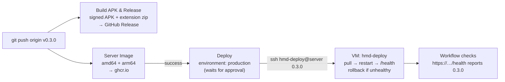

# Releases and deployment

One tag releases everything and, after your approval, deploys the server:



Every run of **Deploy** appears on the repository page under *Deployments → production*, with the version, the commit and whether it succeeded.

## How a deploy works

1. **Server Image** publishes `ghcr.io/w0nb0n/hows-my-download-server:0.3.0`.
2. **Deploy** starts. If the `production` environment requires approval, it waits until you approve it on the run's page.
3. It connects over SSH as `hmd-deploy`. That key is pinned by `authorized_keys` to a single command, [`hmd-deploy`](../deploy/hmd-deploy.sh), and the only thing the workflow sends is the version. Anything that isn't a version (`0.3.0`, `sha-1a2b3c4`) is refused before it reaches docker or sudo.
4. On the VM, `hmd-deploy`:
   - pulls the image and records which version was running;
   - points `HMD_IMAGE` in `/opt/notifs/deploy/.env` at the new version and restarts `notifs-api.service`;
   - waits up to 90 s for `http://127.0.0.1:8000/health` to report the new version;
   - if that never happens, restores the previous version, restarts again, and fails the deploy.
5. The workflow then checks the version through the public HTTPS URL, which also covers Nginx and TLS.

**Rollback by hand.** Run *Actions → Deploy → Run workflow* with an older version, or on the VM: `sudo hmd-deploy 0.2.0`.

**Tests.** CI runs [`deploy/tests/test_hmd_deploy.sh`](../deploy/tests/test_hmd_deploy.sh) and `shellcheck` on every push. The tests cover success, rollback, pull failure, first deploys, and rejection of injected input through the SSH path.

## One-time setup

### 1. On the VM

Copy the CI public key to the VM, then run the setup script from your checkout:

```bash
scp hmd-deploy-ci.pub ubuntu@<vm>:~/
ssh ubuntu@<vm>
cd ~/notifs && git pull
sudo ./deploy/setup-auto-deploy.sh ~/hmd-deploy-ci.pub hmd-api.duckdns.org
```

It creates the `hmd-deploy` user and installs `/usr/local/bin/hmd-deploy`. It allows that user to `sudo` that one file and nothing else, pins the key to it (`restrict`: no shell, no forwarding, no pty), and updates `/opt/notifs/deploy/docker-compose.yml` to the version that uses published images. It finishes by printing the server's SSH host keys for the next step.

### 2. On GitHub

*Settings → Environments → New environment → `production`*:
- **Deployment protection rules:** tick *Required reviewers* and add yourself. Every deploy then waits for your click.
- **Deployment branches:** *Selected branches* → `master`.
- **Environment secret:** `DEPLOY_SSH_KEY` = the CI private key.

*Settings → Secrets and variables → Actions → Variables* (repository variables):

| Variable | Value |
|---|---|
| `PRODUCTION_URL` | `https://hmd-api.duckdns.org` |
| `DEPLOY_HOST` | `hmd-api.duckdns.org` |
| `DEPLOY_USER` | `hmd-deploy` |
| `DEPLOY_KNOWN_HOSTS` | the lines printed by `setup-auto-deploy.sh` |
| `HMD_DEPLOY_ENABLED` | `true`, set last; until then Deploy is skipped |

`DEPLOY_KNOWN_HOSTS` pins the server's identity. With `StrictHostKeyChecking=yes`, the workflow refuses to connect to anything else that answers on that name.

### 3. Try it

*Actions → Deploy → Run workflow*, version `0.2.0` (or any version already on ghcr.io). Approve it, then watch the run. The repository page's *Deployments* section should show it a minute later.

## Security notes

- **What a leaked deploy key allows:** switching the server to another version that is already published on ghcr.io. It can't open a shell, read files, forward ports or run other commands.
- **Approval:** with required reviewers on, the key is only released to a run you approved. Runs from forks never get it.
- **Firewall:** SSH must be reachable from GitHub's runners. Their addresses change, so port 22 can't be restricted to a fixed list. Keep password login disabled in `sshd_config` (Oracle's default).
- **Rotating the key:** generate a new pair, re-run `setup-auto-deploy.sh` with the new public key (it replaces the old one), and update `DEPLOY_SSH_KEY`.
